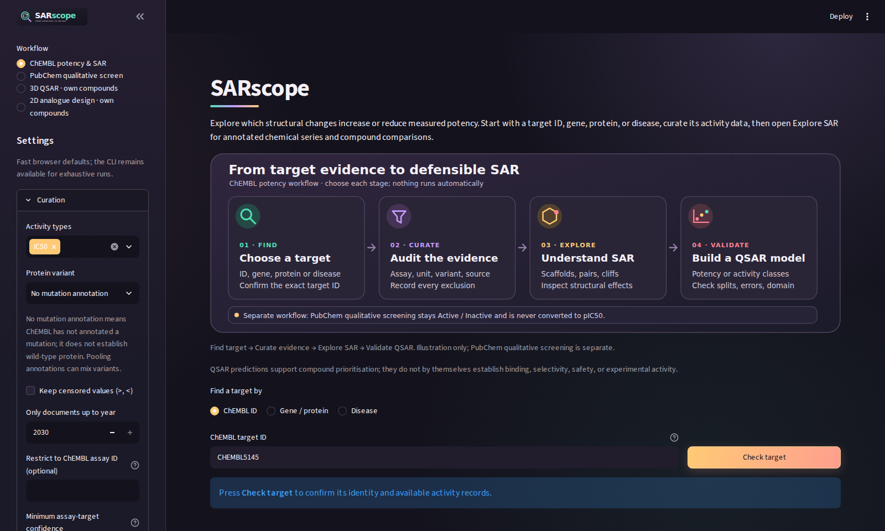

<p align="center">
  
</p>

<p align="center">
  Explore SAR, activity cliffs and 2D/3D-QSAR in one interactive workbench.
</p>

<p align="center">
  <a href="https://sarscope.streamlit.app/">Open the app</a> ·
  <a href="docs/getting-started.md">Get started</a> ·
  <a href="docs/README.md">Documentation</a>
</p>



## What you can do

- **Curate** assay-linked ChEMBL measurements or bring your own compounds.
- **Explore** chemical space, scaffolds, substitution effects and activity cliffs.
- **Model** activity with 2D/3D-QSAR, validation plots and interpretation tools.
- **Reuse** reports, structures, predictions and recorded analysis settings.

Choose each step yourself. Measured evidence, model predictions and proposed
experiments stay distinct.

## Run locally

Python 3.12+; use a fresh virtual environment.

```bash
git clone https://github.com/yboulaamane/sarscope.git
cd sarscope
python -m pip install -e ".[app]"
python -m streamlit run streamlit_app.py
```

Prefer the command line?

```bash
sarscope run CHEMBL5145 --out report/
```

[Workflow guide](docs/user-guide.md) ·
[Methods & validation](docs/README.md#methods-and-evidence) ·
[Paper & SI](submission_mol_inf/README.md) ·
[Contributing](docs/contributing.md)

Research software: assess each model's validation and applicability domain.
Code: [MIT](LICENSE). Datasets retain their own licences and attribution.
