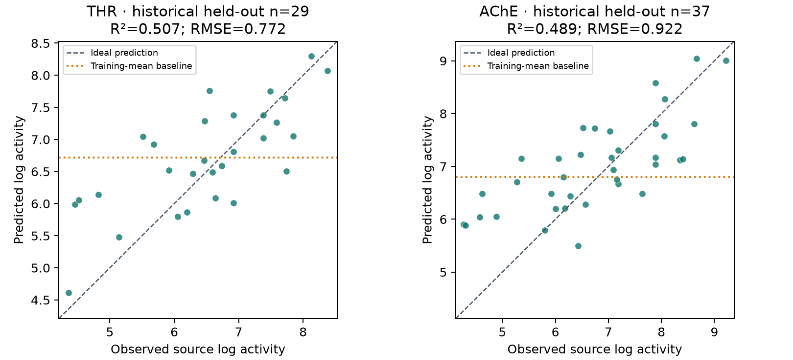

# 3D-QSAR validation update — 18 October 2026

## Decision

SARscope now has additional, reproducible evidence for its own Gaussian-field
implementation. **This is not a fully validated general-purpose 3D-QSAR package.**
The useful paper claim is an independently checked implementation with source
auditing, honest baseline comparisons and explicit model-level qualification.
Neither test thresholds nor failed sensitivity checks were relaxed.

The [historical paper draft](development/3d-qsar-paper-draft.md) separates historical reproduction from
native prediction. The small, generated [evidence snapshot](../benchmarks/field_qsar/validation-20261018/)
contains aggregate tables, protocols, checksums, figures and test records.
Raw source structures and external program code are not bundled there.

## 1. Resolve the source chemistry before interpreting scores

The primary supporting archive for Sutherland, O'Brien and Weaver (2004),
[doi:10.1021/jm0497141](https://doi.org/10.1021/jm0497141), is available from the
[publisher's data repository](https://ndownloader.figshare.com/files/5158327).
Its deposited THR series has 88 closed-shell structures. The later Py-CoMSIA
training files encode a radical electron in each of their 59 training compounds.
This is an encoded-graph discrepancy, not evidence that the measured molecules
were radicals or an assertion about how the discrepancy arose.

All 88 activities, source train/test memberships, heavy-atom positions and heavy
connectivity match after explicit identifier/atom mapping. In all 59 training
records, one bond order and the formal charge differ. The original heavy-atom
coordinate difference is exactly 0 Å. We therefore evaluated the unchanged
primary structures, **not guessed repairs** to the later structures. No compound
was discarded and no activity was rewritten. Original explicit hydrogens and
aligned coordinates were retained; charges were recalculated by the stated
method rather than claimed to be the original authors' partial charges.

The publisher's metadata labels the primary supporting data **CC BY-NC 4.0**.
This is separate from SARscope's code licence and from the later repository's
declared licence. The fetch scripts verify content hashes; no assumption that
all upstream data are MIT or CC BY-SA is made.

Native assay/upload and prepared-input paths now reject encoded radical graphs
with a source-review message. Closed-shell formal ions are allowed. Evidence
ZIPs include a per-compound source-graph audit. The deliberately source-flagged
historical reproduction remains a separate benchmark, not an app validation.

## 2. Does matching LOO recover the published result?

Yes for the external reference program's published five-field thrombin model,
but not exact five-field equivalence for SARscope. The frozen experiment uses
all 59/29 later reference records, the same 1 Å grid/4 Å padding and complete
1–12-component LOO search. The paper's rounded targets and ±0.01 tolerances were
recorded before this experiment.

| Calculator / fields | Components | LOO q² | Training R² | Test R², training target mean only | Historical exported test R² |
| --- | ---: | ---: | ---: | ---: | ---: |
| Published Py-CoMSIA, five fields | 3 | 0.66 | 0.84 | Not reported in that form | 0.51 |
| Executed reference, five fields | 3 | 0.659934 | 0.838262 | 0.475272 | 0.511654 |
| SARscope, five fields | 2 | 0.680827 | 0.816463 | 0.500720 | 0.537103 |
| Executed reference, SEH | 3 | 0.596655 | 0.817219 | 0.524680 | 0.561063 |
| SARscope, SEH | 3 | 0.596655 | 0.817219 | 0.524680 | 0.561063 |

SEH means steric, electrostatic and hydrophobic. The additional two fields are
hydrogen-bond donor and acceptor indicators. SEH test predictions agree to
1.8 × 10⁻¹⁵ after historical block scaling. SARscope's independent five-field
PLS calculation agrees with the reference estimator **on SARscope's own fields**
to 8.9 × 10⁻¹⁵. This rules out a general PLS mismatch in this experiment. The
remaining five-field discrepancy is consistent with the already measured
spatial differences in the hydrogen-bond fields; it does not establish raw
field equality, exact contour equality or proprietary SYBYL compatibility.

The historical representation uses train-and-test field statistics and separate
subset centring. In the reference output, shifting only the supplied test labels
by +10 shifts exported test predictions by +10. The exposed fitted estimator is
trained on centred targets; its activity predictions were reconstructed with
the **training mean only**, verified against training exports. The two test
columns above must not be conflated. Historical reproduction is not evidence
of a deployable prediction procedure. Native SARscope does not use test means.

LOO versus nested CV therefore matters, but is **not the sole explanation**:
grid construction, field screening, component caps and preprocessing also differ
between historical reproduction and native evaluation.

## 3. Native evaluation on the primary structures

The primary profile uses five documented Gaussian fields, Gasteiger charges,
1 Å spacing, 4 Å padding, training-derived per-field filtering (30%, maximum
2000 retained columns), block scaling and an n/5-capped search up to four PLS
components. Three-fold outer CV and inner component selection use seed 42.
The grid is fixed from the complete training cohort, not regenerated within
each CV fold; masks/scales/component selection are refitted within fitting
partitions. Historical test structures are outside all fitting. Ninety-nine
training-label permutations repeat nested selection. The original source SET
partition is retained. No source subset is chosen to fit browser limits.

| Primary-source series | Train/test | Nested pooled q² | Test R² | Test RMSE | Test Spearman | ECFP4 RF RMSE | Training-mean RMSE | Permutation p |
| --- | ---: | ---: | ---: | ---: | ---: | ---: | ---: | ---: |
| Thrombin | 59/29 | 0.607052 | 0.507182 | 0.771571 | 0.690327 | 0.950122 | 1.118904 | 0.01 |
| Acetylcholinesterase | 74/37 | 0.051864 | 0.489004 | 0.922330 | 0.726529 | 0.897955 | 1.291103 | 0.02 |

These are historical log-activity values, unchanged—not newly inferred pIC50
measurements or pooled endpoints. Assay homogeneity has not been independently
re-established from every original experimental record. Previously seen cohorts
are not a new blinded or prospective benchmark. The current numerical profile
was fixed before these runs; earlier AChE results under other profiles were
already known.

Thrombin improves on both baselines by point estimate; AChE does not improve on
RF and has weak internal predictivity despite its positive held-out score.
There is no claim of significant superiority to RF from these point estimates.
The existing strict held-out R² > 0.6 criterion fails for both series. Source
alignment was retained, but the automatic common-core alignment qualification
was deliberately unassessed, not passed by assumption.

Conditional 1000-repeat paired scaffold-block bootstrap R² intervals are
0.196–0.725 (24 test blocks, thrombin) and 0.255–0.626 (30 blocks, AChE).
The RMSE-gain intervals versus the training-mean predictor are 0.137–0.587 and
0.179–0.570 log units. These intervals condition on the fitted model and current
test population. They do not cover retraining uncertainty, model selection,
historical split reuse or future distribution shifts.



The secondary, predeclared thrombin 2 Å/raw profile gives nested q² = 0.395748,
test R² = 0.457963 and RMSE = 0.809184; it is not omitted in favour of the primary
result. Earlier failed benzimidazole, CCR5 and public-SE experiments remain in
their original records. CoMFA-style held-out overlap abstentions remain unresolved.

## 4. Sensitivity and integrity

All ten thrombin training-only sensitivity calculations completed. Nine meet
the existing engineering flags, including common translation, alternate charges
and grid perturbations. One relative-pose perturbation (`pose_1102`) fails:
95th-percentile OOF prediction change 0.598 log units exceeds the prespecified
0.5 limit (maximum change 0.741). This is a real sensitivity warning, not fixed
by selecting another seed. Passing a numerical translation test does not verify
an experimental binding mode or the automatic alignment routes.

Adding +10 to native thrombin test labels changes neither fitted predictions
nor training OOF predictions (maximum absolute change 0). Independent export
verification recomputes native q²/R²/RMSE/MAE/Spearman, RF scores and permutation
p-values from row outputs; verifies 49 manifest-listed files across the two
native runs/reference verification, 51 in the completed reference-driver repeat,
and 31 files inside the native thrombin ZIP;
and confirms all 88 native source-graph audit rows are closed shell.

All **177 targeted tests pass**, covering numerical oracles, source guards,
training-only preprocessing, reproduction, modelling, sensitivity, design,
exports, Streamlit stages and spawned alignment workers. Test-process isolation
was corrected because Streamlit's test runner left temporary `__main__` metadata
that a later spawned worker tried to execute. Production worker logic was not
changed to suppress a real chemistry error.

The broader offline suite also passes: **620 passed, 6 skipped, 2 deselected**
in 222.57 s. The six skips concern unavailable optional UMAP, molfeat, SHAP and
real Vina/docking integrations; they are not tested capabilities on this host.
The two deselected tests require network access. Two small-class warnings came
from a separate 2D example test. A separate seven-test run also passes the new
source-guard and evidence-ZIP audit assertions.

Retained execution problems are distinct from scientific results:

- Initial reference execution lacked an optional `httpx` dependency.
- A completed reference wrapper misread centred estimator outputs and lost
  leading-zero identifiers. A non-refitting verifier corrected interpretation;
  original exports and the wrapper failure remain intact.
- The first thrombin adapter called sensitivity with an obsolete signature;
  the corrected rerun retained the same data/model settings.
- The first AChE run stopped before fitting at a conservative 573 MB estimate.
  The offline memory ceiling alone increased from 512 to 768 MB; source and
  numerical settings stayed fixed. Browser limits were not loosened.
- The first aggregate verifier confused the legacy `baseline_prediction` CSV
  column (RF) with the constant predictor. The corrected verifier checks the
  RF against those rows and reconstructs the constant from training labels;
  no fitted predictions changed.

## Reproduce and audit

From the repository root, use new output directories. The primary-data commands
read the hash-verified publisher ZIP, not guessed SMILES/activities. The optional
download is explicit; the source licence remains separate.

```bash
# Fetch and run the additional primary-source family offline.
OMP_NUM_THREADS=1 OPENBLAS_NUM_THREADS=1 MKL_NUM_THREADS=1 \
.venv/bin/python benchmarks/field_qsar/primary_ache_probe.py \
  --download --original-archive runs/sutherland-source/jm0497141_si_002.zip \
  --out runs/primary-ache-new

# Source-adjudicated THR, including baseline/permutation/sensitivity evidence.
# LATER_DATA must contain hash-matching THR_train.sdf and THR_test.sdf from
# loo-thrombin-20261018-protocol.json. They are used for source mapping/order.
OMP_NUM_THREADS=1 OPENBLAS_NUM_THREADS=1 MKL_NUM_THREADS=1 \
.venv/bin/python benchmarks/field_qsar/primary_thrombin_probe.py \
  --original-archive runs/sutherland-source/jm0497141_si_002.zip \
  --later-data LATER_DATA --out runs/primary-thrombin-new

# Own historical calculation (fetches frozen later sources when offline-data omitted).
OMP_NUM_THREADS=1 OPENBLAS_NUM_THREADS=1 MKL_NUM_THREADS=1 \
.venv/bin/python -m sarscope.field_reproduction \
  --protocol benchmarks/field_qsar/loo-thrombin-20261018-protocol.json \
  --out runs/thrombin-historical-new

# External comparator: separate reference environment, unchanged upstream APIs.
.venv/bin/python benchmarks/field_qsar/matched_loo_probe.py \
  --python REFERENCE_PYTHON --data LATER_DATA \
  --own runs/thrombin-historical-new --out runs/thrombin-reference-new
```

The recorded reference environment uses Python 3.12, NumPy 2.2.4, RDKit
2024.9.6, scikit-learn 1.6.1, pandas 2.2.3 and SciPy 1.15.2; the adapter also
requires matplotlib, seaborn and httpx. Full native parameters/versions and
source hashes are in the snapshot protocols. No external implementation source
was copied or incorporated into SARscope.

The snapshot generator `benchmarks/field_qsar/summarize_20261018.py` verifies the
recorded run layout without refitting; it refuses to overwrite its destination.
The successful AChE reusable-driver repeat reproduces all native summary metrics
to export precision. The corrected reference driver also completes all four
calculations and reproduces the independently verified historical results.
Original failed attempts and raw evidence are retained under
`runs/3dqsar-validation-20261018/` locally; the small tracked
snapshot is not a substitute for archiving that larger evidence at publication.

## Remaining paper/release work

### Reusable example update

The [primary thrombin worked example](primary-thrombin-worked-example.md) now runs
through the actual Streamlit upload/example → profile → preparation → review →
Run workflow. Downloading is explicit, hash-verified and size/time bounded;
separately licensed raw data are not bundled. The loader uses the ordinary upload
function's new opt-in reviewed-state mode and preserves all 88 primary compounds.
An ordinary-curation shadow identity audit rejects alternate parent states as
independent observations without changing any retained graph or activity.

The supplied 59/29 split is explicit, ordered and checked before field calculation.
Partial selection refuses that split; arbitrary uploaded SDF partitions can use
the same mechanism without being labelled independent or benchmark validation.
The reference profile explicitly opts into 20,000 grid points / 512 MB estimated
field workspace. Default browser limits remain 12,000 / 256 MB; shared-host total
memory is not guaranteed by this estimate.

The actual 99-permutation native fit in Streamlit AppTest reproduces q² =
0.6070519813940478, test R² = 0.5071821301111985 and RMSE = 0.771570968908504.
The targeted expanded run passes 85 tests. Tests also verify no automatic fetching,
fitting or review; source state/partition retention; rejected parent duplicates;
unchanged strict qualification; subset refusal; and safe example switching/reset.
WebGL rendering and a human's chemical pose review are not established by AppTest.
The former no-UI-integration limitation is addressed, not the independent-review
or external-predictivity gaps.

The subsequent expanded offline suite passes **627 tests**, with six optional
dependency skips and two network tests excluded. The
[committed JUnit record](../benchmarks/field_qsar/primary-ui-20261018/) includes
the actual UI-fit metrics/settings and tested source hashes. The earlier 620-test
record remains unchanged as evidence for the preceding revision.

### Outstanding scientific and release gates

Freeze the supported workflow before a genuinely untouched external evaluation;
obtain independent scientific review; test generated-alignment robustness on
multiple measured series; resolve the strict LJ/Coulomb prediction contract;
archive licensed raw evidence with a release DOI; and complete the existing
manuscript's author, funding, conflict and case-review checks. The paper must
retain model failures and the H-bond-field non-equivalence. None of these is
resolved by renaming a metric, lowering a threshold or using a favourable demo.

The [independent-review handoff](development/3d-qsar-external-review.md) specifies what a
reviewer should reproduce and what must be frozen before new labels are seen.
It is a prepared request, not a claim that review or external validation has
already taken place.
