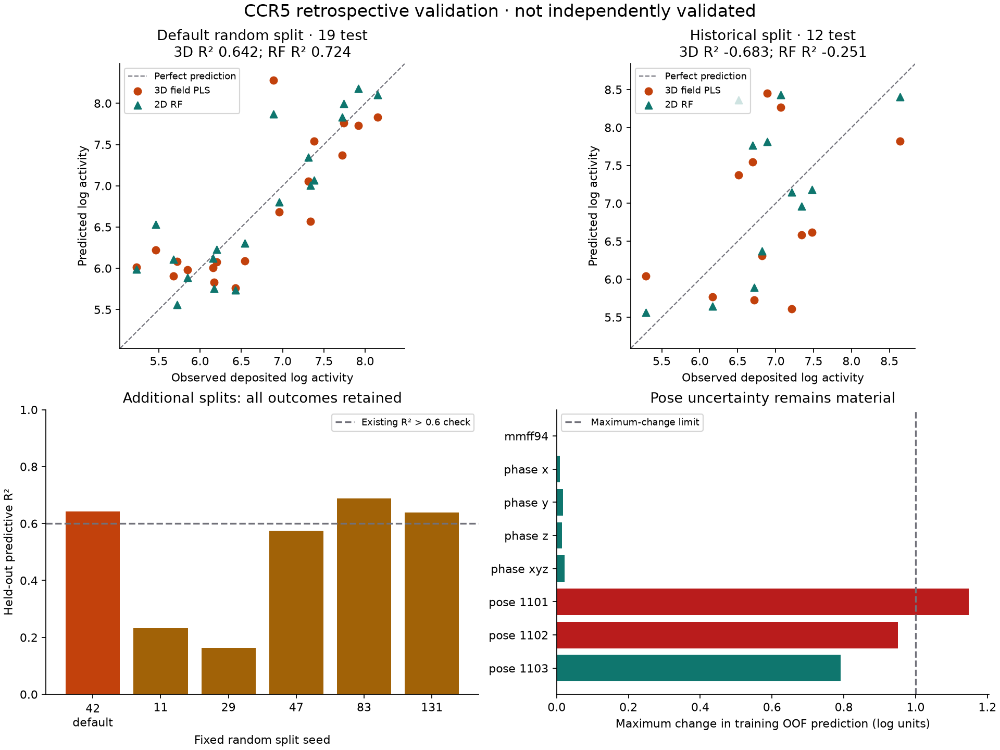

# CCR5 tutorial: validation attempt, 17 October 2026

**Decision: numerically reproducible teaching example, with an alignment
availability issue; NO-GO for a validated predictive lead-optimisation claim.**
The default positive result reproduces when preparation completes, and the
post-alignment leakage controls pass. However, the current workflow fails
the historical test split and scaffold extrapolation, has material pose
sensitivity, and has no fresh independent validation cohort. A low permutation
p-value does not override those failures. No threshold or preset was changed.



## What was frozen and tested

The [protocol](../benchmarks/field_qsar/ccr5-demo-validation-protocol.json) and
[execution freeze](../benchmarks/field_qsar/ccr5-demo-validation-20261017/freeze.json)
record the source/data/code SHA-256 hashes, resolved settings and numerical
environment **before this run**. These are retrospective experiments: all 75
public compounds had already been inspected during development. Neither the
historical split nor the additional random partitions are newly independent
external evidence. The earlier negative campaigns remain unchanged.
CCR5 was chosen to supply a positive tutorial after examining weaker examples;
that development selection is another reason its favourable demo score cannot
serve as an unbiased benchmark of the package.

The runner uses the actual offline example loader, upload curation, alignment
review preparation and native field/regression pipeline, not an imported
QSAR model or a substitute solver. Source activities are unchanged. The
neutral-parent structures retain source heavy-atom coordinates and bonds;
their protonation states and supplied alignment remain modelling assumptions.
All 75 unique encoded graphs and identifiers are retained. Original assay
conditions have not been independently adjudicated for every measurement.

A [separate source check](../benchmarks/field_qsar/ccr5-source-audit-20261017.json)
compares the hash-verified deposited SDFs directly with the bundled derivative
using exact one-to-one heavy-atom coordinate correspondence, rather than trusting
the preparation audit's Boolean flags. All 75 activities, elements, heavy-atom
bonds and heavy-atom coordinates agree; all 75 formal charge states change
from the protonated source to the neutral-parent derivative. This validates
that preparation record, not the physiological appropriateness of neutralisation.

The frozen model is the app tutorial profile: five Gaussian field blocks,
Gasteiger charges, 2 Å enclosing grid, raw units, per-field 30% screening,
at most 2,000 retained descriptors, up to four PLS components with an n/5 cap,
and nested three-fold component selection. Primary random hold-out is 25%,
seed 42; two components are selected. The validation run increases only the
permutation count (19 to 199) and its execution budget, not predictive settings.
Every baseline uses the identical train/test membership.

## Prediction: success on the default split does not generalise reliably

| Partition | Train/test | 3D nested pooled q² | 3D test R² | 3D RMSE | 2D RF RMSE | Training-mean RMSE |
| --- | ---: | ---: | ---: | ---: | ---: | ---: |
| Tutorial random, seed 42 | 56/19 | 0.499 | 0.642 | 0.521 | 0.457 | 0.870 |
| Original historical membership | 63/12 | 0.735 | **−0.683** | 0.994 | 0.857 | 0.813 |
| Murcko scaffold groups, seed 42 | 67/8 | 0.318 | **−3.184** | 1.364 | 1.133 | 0.713 |

The historical and scaffold models are worse than a constant fitted using
training labels. The scaffold algorithm preserves groups, so its realised
8-compound test size differs from a nominal 25% hold-out. It is small and
uncertain, not a precise estimate of general scaffold performance, but it
does not support a successful extrapolation claim.

Five additional seeds were fixed before this execution. All results are
retained and **none replaces seed 42**:

| Seed | Nested pooled q² | Test R² | Test RMSE |
| ---: | ---: | ---: | ---: |
| 11 | 0.568 | 0.233 | 0.552 |
| 29 | 0.603 | 0.162 | 0.563 |
| 47 | 0.536 | 0.575 | 0.609 |
| 83 | 0.407 | 0.689 | 0.543 |
| 131 | 0.452 | 0.639 | 0.495 |

The previously recorded seeds 7, 19, 73 and 101 remain in the tutorial's
verification file. Across those nine diagnostic repeats, test R² spans
approximately **0.162–0.689**. Their overlapping compounds and fitting sets
make these sensitivity checks, not nine independent replications.

The default test compounds have median nearest-training ECFP4 Tanimoto
similarity **0.821**. This chiefly assesses close-analogue interpolation.
There are nine Murcko groups overall and only five in the default test set.

## Uncertainty and label randomisation

The 2,000 paired held-out scaffold-block bootstrap resamples give the following
conditional 95% percentile intervals:

| Default 3D metric | Estimate | 95% interval |
| --- | ---: | ---: |
| Predictive R² | 0.642 | −2.171 to 0.809 |
| RMSE | 0.521 | 0.372 to 0.967 |
| RMSE gain over training-mean prediction | 0.350 | −0.357 to 0.520 |
| RMSE gain over same-split 2D RF | −0.063 | −0.198 to 0.136 |

With five resampled scaffold blocks, these intervals are unstable and must
not be treated as precise uncertainty under new experiments, retraining or
chemical-series shift. In particular, the gain interval includes zero, and
the evidence does not establish a 3D improvement over the simpler 2D baseline.

None of the 199 full-pipeline training-label permutations reaches the observed
primary pooled q²: **p = (1 + 0)/(1 + 199) = 0.005**. Inner component selection
is repeated for each shuffle. This supports an association in this training
sample, conditional on the existing preprocessing and settings; it does not
validate the selected workflow, a binding mechanism, a new chemical series,
or the historical held-out predictions. The historical fit has p = 0.01
with 99 permutations yet still fails predictive evaluation.

## Leakage and numerical controls

On these actual CCR5 data, after preparation/alignment:

- Adding 20 log units to **only held-out activities** leaves the grid, training
  descriptors, feature mask, column means/scales, selected components,
  coefficients, training out-of-fold predictions and held-out predictions
  unchanged within 1e−10.
- Translating **only held-out coordinates** by (100, −80, 60) Å leaves the same
  training quantities unchanged. Query predictions may change; the deliberately
  displaced poses are not proposed as scientifically admissible inputs.
- A common translation of the whole training series changes out-of-fold
  predictions by at most **1.78 × 10⁻¹⁵**, passing the existing 1e−8 control.

These controls do not establish that all preprocessing is fully inductive:
common-core QC uses the whole series' structures, and nested CV uses a grid
bounded by the full outer-training geometry. Masks, scales and component
selection are fold-local; the enclosing grid is not rebuilt separately in
every inner fold. Supplied historical poses may themselves encode choices
made during development of the published benchmark. This is not proof of
label leakage, but it limits a claim of fully nested geometry preparation.

## Stability and field interpretation

All ten predeclared training-only diagnostics completed. Charge-model and grid
phase checks pass the existing engineering thresholds. However, relative
rigid perturbations of only 0.25 Å and 5° give:

| Perturbation seed | OOF change, 95th percentile | Maximum change | Existing stability flag |
| ---: | ---: | ---: | --- |
| 1101 | 0.573 | 1.148 | Fail |
| 1102 | 0.645 | 0.950 | Fail |
| 1103 | 0.497 | 0.791 | Pass |

The limits are p95 ≤ 0.5 and maximum ≤ 1.0 log units; they are engineering
flags, not universal scientific validity criteria. These are pose-uncertainty
stress tests, not alternative experimentally verified binding conformations.
No better-looking variant is selected to replace the preset.

The raw-scale default's coefficient × training-standard-deviation accounting
attributes **99.22%** of absolute contour contribution to the steric block.
Electrostatics account for **0.017%**. These are model-specific contribution
summaries, not causal fractions of binding free energy. Thus tiny changes
between Gasteiger and MMFF94 do not prove that charge/protonation is irrelevant
to the real CCR5 interaction, nor validate a five-field mechanistic explanation.

## Release interpretation and remaining work

Software checks establish specified numerical behaviour and reproducibility,
not predictive success on every endpoint. The existing numerical oracles test
LJ/Coulomb/Gaussian equations, charge controls, rigid transformations, PLS,
filtering and contour/export conventions. The full current offline suite and
the new frozen-evidence checks are recorded with this validation delivery.

There is also an unresolved operational limit: the full offline suite exposes
MCS preparation timeouts at the existing five-second pair-search budget for
compound `70` (12/75) in the first run and `CCR5_42` (49/75) in the repeat,
causing five tests that share that setup to error.
This recurs with bounded CPU parallelism, so simple overload is not an
established explanation. An isolated native model fit and a separate Streamlit
preparation check succeed, while another UI preparation test fails. Do not
describe the full software suite as green or the demo as operationally reliable
on every run. No search limit was increased and no failed test was skipped.
The [targeted test record](../benchmarks/field_qsar/ccr5-demo-tests-20261017.xml)
retains its failure; the [six evidence-audit tests](../benchmarks/field_qsar/ccr5-evidence-audit-tests-20261017.xml)
pass, independently recalculating metrics and checking retained failures/hashes.

The [complete bounded-parallelism offline run](../benchmarks/field_qsar/ccr5-offline-tests-bounded-20261017.xml)
finishes with **586 passed, 6 skipped, 5 setup errors**, and two live-network
tests deselected (324.65 seconds). The earlier unbounded run had 581 passed,
6 skipped and the same five dependent setup errors, before the new evidence
tests were collected. The six separately executed evidence-audit tests pass;
five were also collected in the full run, and their count must not simply be
added as independent tests. The sixth source-audit record test was added later.
Ruff checks/formatting, mypy on 71 source files, and `git diff --check` pass.

No algebraic or held-out-label-leakage defect was found in the paths checked.
That does **not** rule out every possible implementation defect, establish
vendor equivalence, or prove that a disappointing series is simply "bad data".
The observed failure belongs to this combination of representation, historical
alignment, modelling assumptions, fitting method and evaluation population.
Further method development must be distinguished from its eventual evaluation.

**Use now:** a measured, positive tutorial demonstrating fitting, plots,
contours, applicability-domain warnings and exploratory design controls.
Keep the unvalidated-model warning and explicit exploratory consent.

**Do not claim:** a validated lead-optimisation model, reliable scaffold
extrapolation, experimentally confirmed poses/assay comparability, superiority
over 2D RF, or numerical equivalence to proprietary SYBYL.

The lowest-cost useful next test is a predeclared, training-only alignment
robustness investigation, evaluated without further reference to these test
scores. Any replacement procedure then needs a **newly reserved, assay-adjudicated
measured series**, with code/preparation/model settings frozen before its
activities are evaluated. The historical CCR5 test set and the consumed ATA
benchmark cannot become fresh again by renaming or resplitting them.

## Reproduce and inspect

```bash
.venv/bin/python benchmarks/field_qsar/validate_ccr5_demo.py \
  --out runs/ccr5-validation-new
.venv/bin/python -m pytest -q tests/test_ccr5_validation_record.py
```

No network or external QSAR package is required. Use a new output directory;
the runner refuses to overwrite earlier evidence. Approximate statistical
thresholds are not relaxed on a rerun. The frozen workflow used RDKit
2026.09.1, NumPy 2.5.4, pandas 3.0.6 and scikit-learn 1.9.1.

Evidence: [assessment](../benchmarks/field_qsar/ccr5-demo-validation-20261017/assessment.json),
[all file hashes](../benchmarks/field_qsar/ccr5-demo-validation-20261017/manifest.sha256.json),
[row-level predictions](../benchmarks/field_qsar/ccr5-demo-validation-20261017/primary/predictions.csv),
[historical failures](../benchmarks/field_qsar/ccr5-demo-validation-20261017/historical-63-12/predictions.csv),
[bootstrap](../benchmarks/field_qsar/ccr5-demo-validation-20261017/bootstrap.csv),
[stability](../benchmarks/field_qsar/ccr5-demo-validation-20261017/stability.csv).

Measured-data provenance: [Aher et al., 2007](https://doi.org/10.1007/s00894-007-0173-z),
deposited aligned data in [Haga et al., 2025](https://doi.org/10.3390/ph18030440).
The deposited dataset is CC BY-SA 4.0; SARscope's derivative-data attribution
and preparation audit remain bundled with the tutorial. These scientific
source citations are not endorsements of SARscope's validation outcome.
